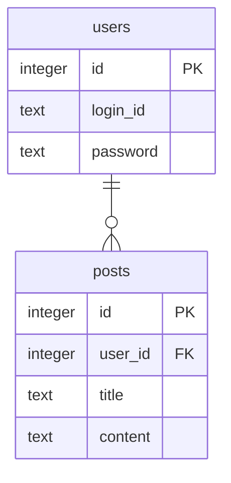

# projectcode-diagram

받은 폴더의 코드를 읽어 그 장이 끝난 시점의 도식을 만든다. 코드는 고치지 않는다.
그 폴더가 메인인지 샌드박스인지는 상관하지 않는다.

## 받는 것

| 받는 것 | 예 |
|---|---|
| 폴더 | 예제 저장소, 또는 fix의 샌드박스 worktree |
| 장 | signup-form |

## 파일

```
.projectcode/chapters/<장>/diagrams/
  flow.md       흐름. Mermaid
  erd.md        ERD. Mermaid erDiagram. 데이터가 있는 장만
  tree.md       폴더 구조도. tree.mjs가 만든다
```

## Mermaid 규칙

강의프로그램 앱이 이 도식을 그대로 그린다. 모양은 앱이 정하므로 꾸미지 않는다.
- 색, 테마, classDef, style, linkStyle, %%{init}%%, frontmatter 설정을 쓰지 않는다
- 강조는 라벨 안 **굵게**만 쓴다
- 라벨은 한국어 12자 안팎으로 짧게 쓴다
- 괄호가 들어간 라벨은 큰따옴표로 감싼다

## 순서

1. 읽기
   이 장의 spec.md 흐름과 plan.md, 받은 폴더의 코드를 읽는다. 기준은 코드다.

2. 흐름
   spec의 흐름 줄을 실제 코드에 맞춰 그린다.
   - 화면 안에서만 흐르면 flowchart LR
   - 화면과 서버가 주고받으면 sequenceDiagram. 참여자는 4~5개 안쪽이다
   - 주 흐름은 한 줄로 이어지게 쓰고 갈래는 꼭 필요할 때만 둔다
   - 코드 이름은 12자 안에 들어갈 때만 괄호로 붙인다. 예: C["클릭 (handleSubmit)"]
   - 상자는 열 개 안쪽으로 둔다. 이 장에서 생긴 흐름만 그린다

3. ERD
   저장하는 데이터가 있으면 그 장 시점의 전체 테이블을 그린다.
   - 테이블과 칸 이름은 코드에 쓴 그대로 쓴다. 학생이 코드와 바로 이어 보게 한다
   - 칸마다 타입을 쓰고 PK, FK를 붙인다
   - 관계선 글자는 비운다
   - 방향은 적지 않는다
   - 이 장에서 생기거나 바뀐 테이블은 그림 아래에 한 줄씩 적는다
   - 데이터가 없는 장은 erd.md를 만들지 않는다

4. 폴더 구조도
   받은 폴더에서 실행한다. 앞 장 태그는 roadmap에서 바로 앞 장의 done/<장>이다.
   node .claude/skills/projectcode-diagram/tree.mjs done/<앞 장> > .projectcode/chapters/<장>/diagrams/tree.md
   첫 장은 태그 없이 실행한다.

5. 확인
   Mermaid 문법이 맞는지 본다. 기준은 앱이 쓰는 mermaid 11.17.2다.
   도식에 코드에 없는 것이 들어가지 않았는지 본다.

6. 마무리
   tasks.md의 도식을 체크한다. 커밋은 하지 않는다. [장] 완료 커밋에 들어간다.
   다음은 projectcode-task(끝낼 때)라고 알린다.

## flow.md 예시

````
# signup-form 흐름


````

## erd.md 예시

````
# post-write ERD



이 장에서 생긴 것
- posts 테이블
````

## tree.md 예시

````
# 폴더 구조

비교 기준: done/project-setup. 새로 생긴 파일과 고친 파일을 표시했다.

```
src/
  App.jsx   고침
  SignupForm.jsx   새로
  main.jsx
index.html
package.json
```
````
