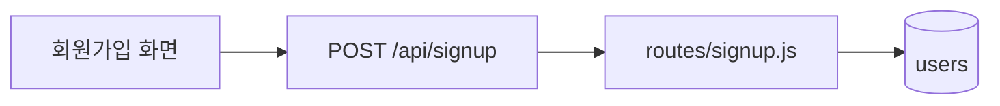
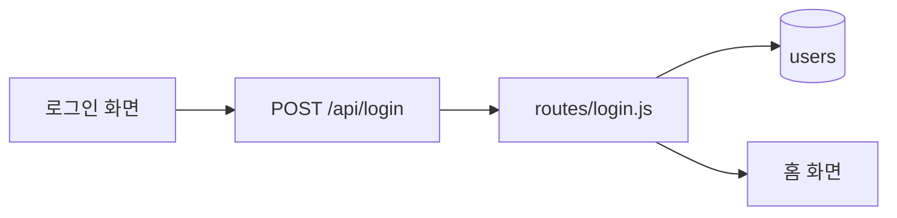

# projectcode-wiki

예제 프로젝트 전체를 한눈에 본다. 원본(roadmap, 장 문서, 코드)을 읽어서 wiki만 쓴다.
원본은 고치지 않는다. 어긋난 것은 점검에 적기만 한다.

## 언제

- projectcode-task가 장을 완료했을 때
- projectcode-fix가 수정 완료를 했을 때
- 사용자가 요청할 때

## 파일

| 파일 | 내용 | 원본 |
|---|---|---|
| overview.md | 강의 이름, 대상, 결과물, 장 표(번호, 장, 종류, 배울 것, 상태, task 수, 사진 수), 미룬 것, 하지 않는 것 | roadmap.md, 장마다 tasks.md와 captures/ |
| concepts.md | 선수 지식, 배울 것마다 처음 나온 장 | roadmap.md |
| scenarios.md | 시나리오별 구조도. 회원가입, 로그인처럼 사용자가 처음부터 끝까지 하는 일 하나마다 | 코드, 장마다 spec.md 흐름 |
| screens.md | 화면마다 처음 나온 장, 그 화면의 장 끝 사진 | 장마다 captures.md |
| erd.md | 지금의 ERD | 가장 최근 장의 erd.md |
| tree.md | 지금의 폴더 구조 | 가장 최근 장의 tree.md |
| check.md | 점검 결과 | 아래 점검 |

wiki 전체를 매번 처음부터 다시 쓴다. 원본에 없는 것은 쓰지 않는다.
screens.md의 사진은 그림으로 넣는다. 문서 규칙의 링크 금지에서 이것만 예외다.

## 시나리오별 구조도

- 시나리오 하나는 사용자가 처음부터 끝까지 하는 일 하나다. 예: 회원가입, 로그인, 글쓰기
- 시나리오는 여러 장에 걸친다. 예: 회원가입 = signup-form, signup-api, signup-connect
- 지금 코드를 기준으로 그린다. 상자는 화면, 요청 주소, 서버 파일, 테이블이다
- 상자 이름은 화면 이름이나 코드 이름을 쓴다. 연결선에는 글자를 쓰지 않는다
- 시나리오마다 만든 장과 맡는 파일을 아래에 적는다
- Mermaid 규칙은 projectcode-diagram과 같다

## 점검

| 점검 | 맞는 상태 |
|---|---|
| 장 상태 | 완료인 장은 tasks.md가 모두 체크돼 있고 done 태그가 있다 |
| 진행 중 | 진행 중인 장은 하나 이하다 |
| 장 자료 | 완료인 장은 captures.md와 tree.md가 있다. 화면이 있는 장은 장 끝 사진이 있다 |
| 사진 | captures.md의 파일이 모두 있다. 다시 찍지 못한 사진은 목록으로 보여준다 |
| 미룬 것 | 미룬 것마다 어느 장에서 할지 정해져 있거나, 아직 정하지 않았다고 표시한다 |
| 테스트 | 모든 장의 테스트가 통과한다 |

어긋난 것은 check.md에 장, 무엇, 어느 파일인지 한 줄씩 쓴다. 고치는 것은 사용자가 정한다.

## 순서

1. 읽기
   roadmap.md, contract.md, 장마다 spec.md, tasks.md, captures.md, diagrams/를 읽는다.
   git tag로 done 태그를 확인하고, 모든 장의 테스트를 실행한다.

2. 쓰기
   위 파일들을 .projectcode/wiki/에 다시 쓴다.

3. 커밋
   제목: [projectcode] wiki 갱신
   본문: Kind: docs

4. 알리기
   점검에서 어긋난 것이 있으면 개수와 함께 보여준다. 없으면 없다고 한 줄로 알린다.

## overview.md 예시

```
# 회원가입과 로그인으로 배우는 React와 Express

대상: HTML, CSS, JS 기초를 아는 학생
결과물: 가입하고 로그인하는 웹 앱

| 번호 | 장 | 종류 | 배울 것 | 상태 | task | 사진 |
|---|---|---|---|---|---|---|
| 1 | project-setup 프로젝트 뼈대 | 기능 | 프로젝트 구조, 실행 방법 | 완료 | 3 | 4 |
| 2 | signup-form 회원가입 폼 | 기능 | 컴포넌트, JSX, useState | 완료 | 3 | 4 |
| 3 | signup-api 회원가입 API | 기능 | Express 라우트, SQLite 저장 | 진행 중 | 2 | 1 |

## 미룬 것
- 입력 검사: 장 정하지 않음

## 하지 않는 것
- 배포
```

## scenarios.md 예시

````
# 시나리오별 구조도

## 회원가입



만든 장: signup-form, signup-api, signup-connect
맡는 파일
- src/SignupForm.jsx
- server/routes/signup.js
- server/db.js

## 로그인



만든 장: login
맡는 파일
- src/LoginForm.jsx
- server/routes/login.js
````

## screens.md 예시

```
# 화면 모음

## 회원가입 화면
처음 나온 장: signup-form


```
