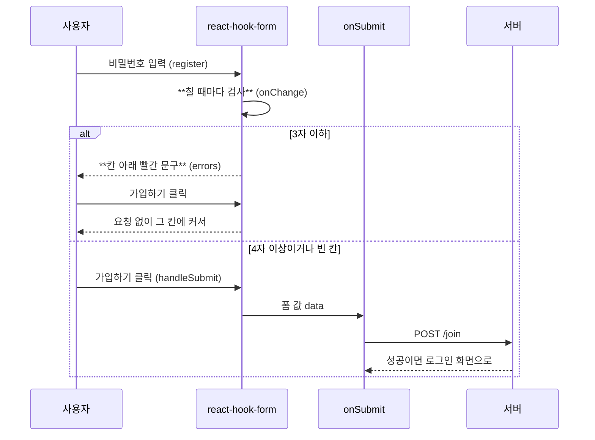
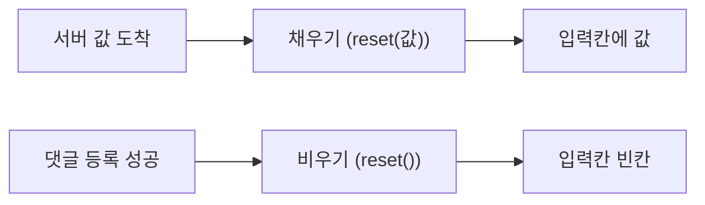

# form-hook 흐름

폼 값은 react-hook-form이 맡는다. 입력칸은 register로 붙고, 가입하기는 handleSubmit이 받는다.
회원가입 비밀번호는 칠 때마다 4자 규칙을 검사한다. 빈 칸은 검사하지 않고 지금처럼 서버가 막는다.
규칙에 걸리면 요청 없이 그 칸으로 커서가 간다. 맞으면 폼 값 data를 onSubmit에 넘겨 보낸다.

글 수정과 내 정보는 서버 값이 오면 reset(값)으로 채운다. 댓글은 등록 뒤 reset()으로 비운다.

