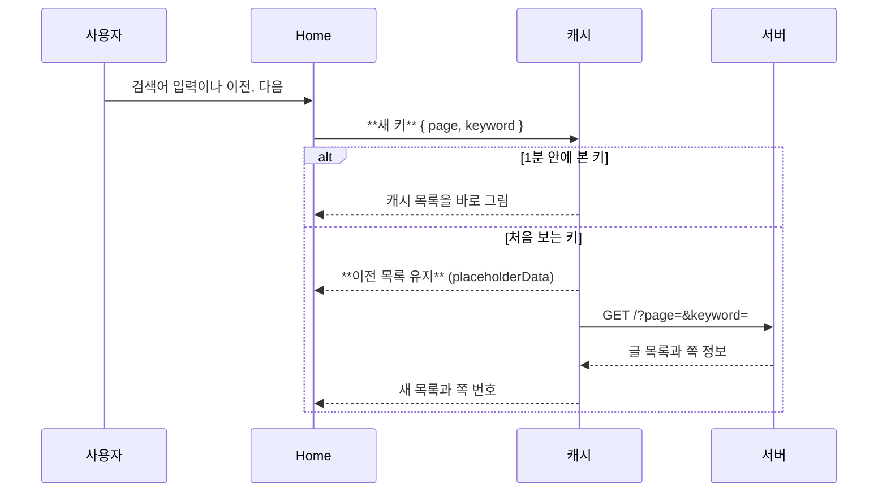

# paging-search 흐름

목록 키는 ["boards", "list", { page, keyword }]다. 페이지와 검색어마다 캐시 칸이 따로 생긴다.
검색어가 바뀌면 page를 0으로 돌려 첫 페이지부터 본다.
처음 보는 키는 placeholderData로 앞 키의 목록을 보인 채 받는다. 로딩으로 바뀌지 않아 검색창의 커서가 남는다.

글을 쓰거나 고치거나 지우면 ["boards", "list"]를 무효화한다. 앞부분이 같은 모든 페이지와 검색 키에 걸린다.

