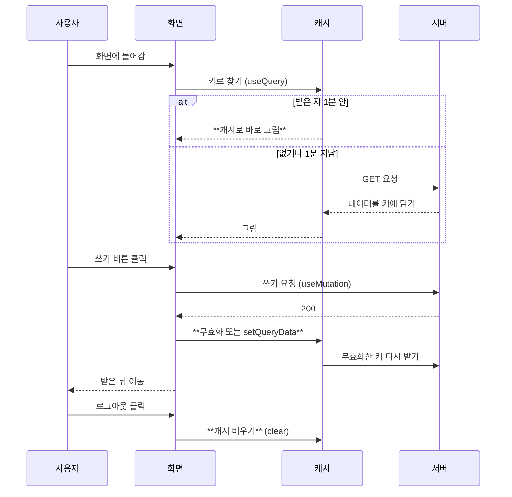

# react-query 흐름

화면은 서버 대신 캐시에 데이터를 묻는다.
키는 목록 ["boards", "list"], 상세와 글 수정 ["boards", "detail", id], 내 정보 ["user"]다.
쓰기 뒤 캐시 처리는 글쓰기와 삭제는 목록 무효화, 글 수정은 상세와 목록 무효화, 댓글은 상세 무효화, 내 정보는 setQueryData다.

