# 시나리오별 구조도

## 앱 띄우기와 메뉴 이동

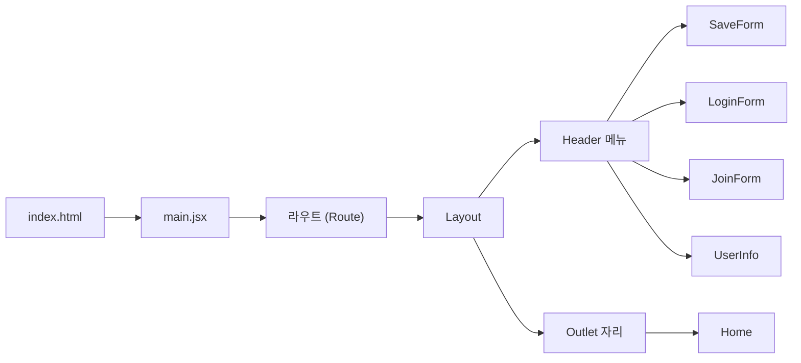

만든 장: project-setup, layout, screens, react-query
맡는 파일
- react-blog/index.html
- react-blog/src/main.jsx
- react-blog/src/App.jsx
- react-blog/src/components/Layout.jsx
- react-blog/src/components/Header.jsx
- react-blog/src/pages/Home.jsx
- react-blog/src/pages/SaveForm.jsx
- react-blog/src/pages/LoginForm.jsx
- react-blog/src/pages/JoinForm.jsx
- react-blog/src/pages/UserInfo.jsx
- react-blog/src/index.css

## 글 목록 보기

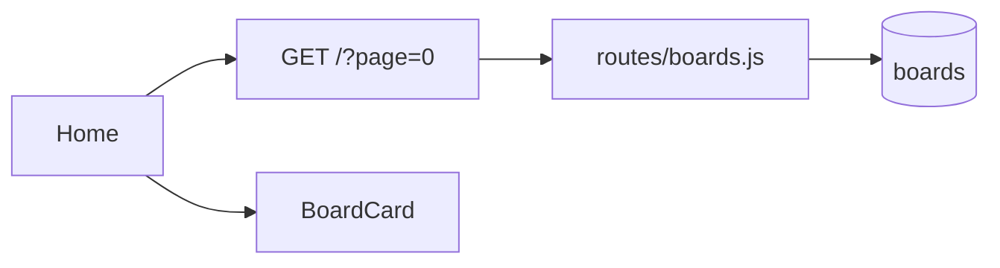

만든 장: screens, component-split, board-list, board-save, react-query
맡는 파일
- react-blog/src/pages/Home.jsx
- react-blog/src/components/BoardCard.jsx
- react-blog/src/api/http.jsx
- server-node/src/routes/boards.js
- server-node/src/db.js

## 글 상세 보기

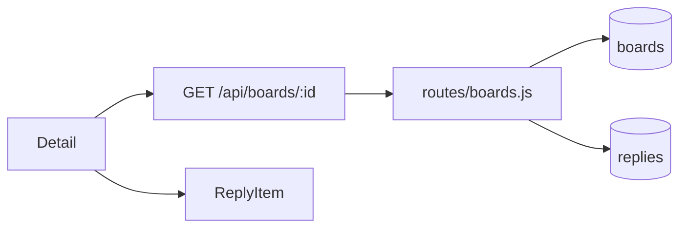

만든 장: screens, component-split, board-detail, board-save, react-query
맡는 파일
- react-blog/src/pages/Detail.jsx
- react-blog/src/components/ReplyItem.jsx
- react-blog/src/api/http.jsx
- server-node/src/routes/boards.js
- server-node/src/db.js

## 글 수정

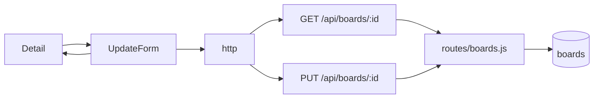

만든 장: screens, component-split, board-detail, board-update-delete, react-query
맡는 파일
- react-blog/src/pages/Detail.jsx
- react-blog/src/pages/UpdateForm.jsx
- react-blog/src/components/FormCard.jsx
- react-blog/src/components/Input.jsx
- react-blog/src/api/http.jsx
- react-blog/src/App.jsx
- server-node/src/routes/boards.js
- server-node/src/auth.js

## 글 삭제

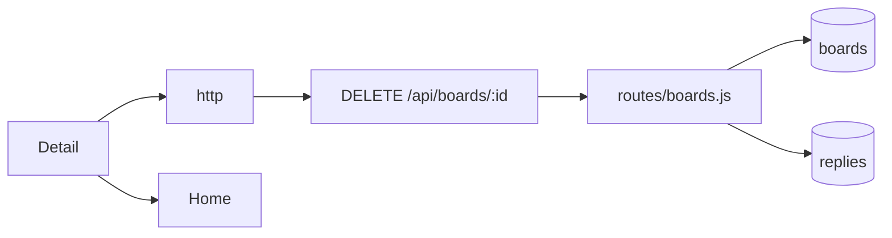

만든 장: screens, board-detail, board-update-delete, react-query
맡는 파일
- react-blog/src/pages/Detail.jsx
- react-blog/src/api/http.jsx
- server-node/src/routes/boards.js
- server-node/src/auth.js

## 댓글 쓰기

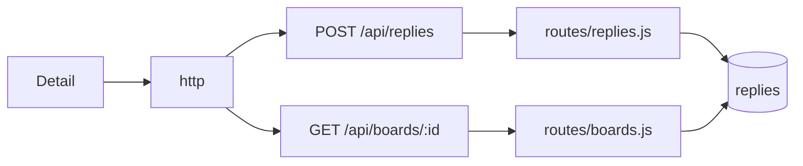

만든 장: screens, board-detail, board-save, reply, react-query
맡는 파일
- react-blog/src/pages/Detail.jsx
- react-blog/src/api/http.jsx
- server-node/src/routes/replies.js
- server-node/src/routes/boards.js
- server-node/src/auth.js

## 댓글 삭제

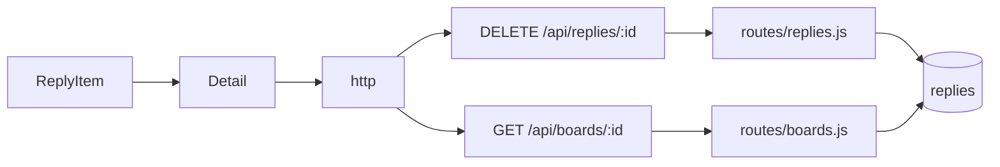

만든 장: screens, component-split, board-detail, board-save, reply, react-query
맡는 파일
- react-blog/src/components/ReplyItem.jsx
- react-blog/src/pages/Detail.jsx
- react-blog/src/api/http.jsx
- server-node/src/routes/replies.js
- server-node/src/routes/boards.js
- server-node/src/auth.js

## 회원가입

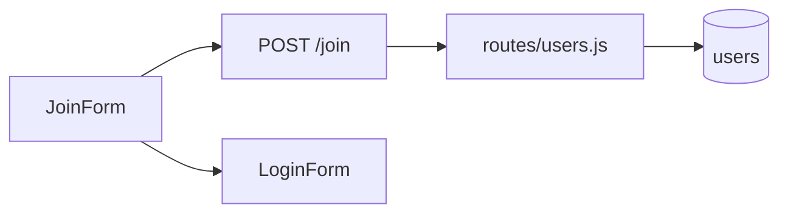

만든 장: screens, component-split, join, board-save
맡는 파일
- react-blog/src/pages/JoinForm.jsx
- react-blog/src/components/FormCard.jsx
- react-blog/src/components/Input.jsx
- react-blog/src/api/http.jsx
- server-node/src/routes/users.js
- server-node/src/db.js

## 로그인과 로그아웃

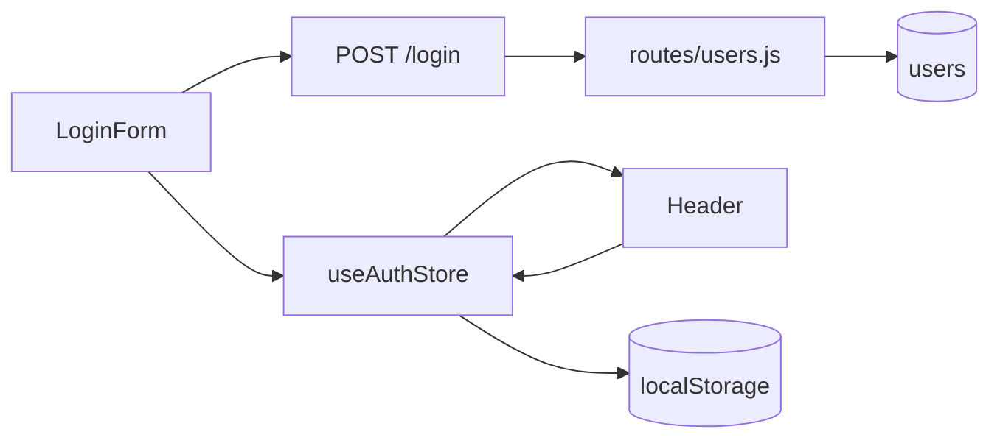

만든 장: screens, component-split, login, login-keep, board-save, react-query
맡는 파일
- react-blog/src/pages/LoginForm.jsx
- react-blog/src/store/authStore.jsx
- react-blog/src/components/Header.jsx
- react-blog/src/components/FormCard.jsx
- react-blog/src/components/Input.jsx
- react-blog/src/api/http.jsx
- server-node/src/routes/users.js
- server-node/src/auth.js

## 글쓰기

만든 장: screens, component-split, board-save, react-query
맡는 파일
- react-blog/src/pages/SaveForm.jsx
- react-blog/src/components/FormCard.jsx
- react-blog/src/components/Input.jsx
- react-blog/src/api/http.jsx
- server-node/src/routes/boards.js
- server-node/src/auth.js

## 내 정보 수정

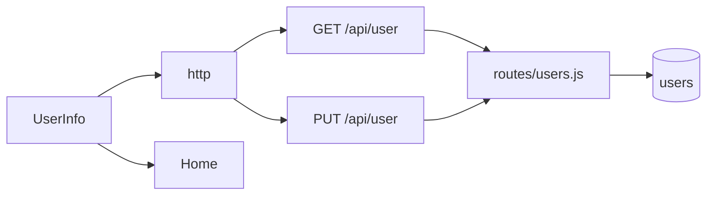

만든 장: screens, component-split, board-save, my-info, react-query
맡는 파일
- react-blog/src/pages/UserInfo.jsx
- react-blog/src/components/FormCard.jsx
- react-blog/src/components/Input.jsx
- react-blog/src/api/http.jsx
- server-node/src/routes/users.js
- server-node/src/auth.js

## 폼 화면 조각

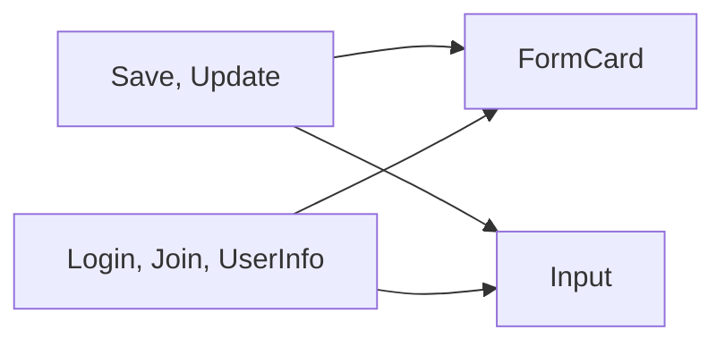

만든 장: screens, component-split
맡는 파일
- react-blog/src/components/FormCard.jsx
- react-blog/src/components/Input.jsx
- react-blog/src/pages/SaveForm.jsx
- react-blog/src/pages/UpdateForm.jsx
- react-blog/src/pages/LoginForm.jsx
- react-blog/src/pages/JoinForm.jsx
- react-blog/src/pages/UserInfo.jsx

홈 목록과 상세는 서버에서 받는다.
회원가입은 서버에 저장한다.
로그인은 토큰을 받아 스토어에 기억하고 헤더가 그것을 본다.
토큰은 localStorage에도 남아 새로고침해도 로그인이 유지된다. 로그아웃하면 지운다.
서버 요청은 모두 http를 지나고 로그인했으면 토큰이 붙는다.
글쓰기는 토큰과 함께 보내고 홈으로 간다.
상세는 owner가 true인 내 글에만 수정, 삭제 버튼을 보인다.
글 수정은 기존 값을 채운 폼으로 PUT을 보내고 상세로 간다. 글 삭제는 DELETE를 보내고 홈으로 간다.
댓글은 등록하거나 owner인 댓글의 휴지통을 누르면 서버에 보내고 상세를 다시 받는다.
내 정보는 받은 아이디와 이메일로 폼을 채우고 수정하기를 누르면 PUT을 보내고 홈으로 간다.

## 캐시로 그리기와 다시 받기

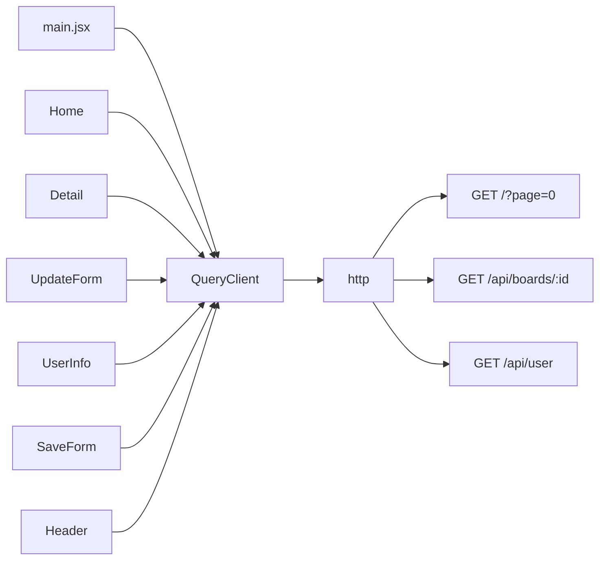

만든 장: react-query
맡는 파일
- react-blog/src/main.jsx
- react-blog/src/pages/Home.jsx
- react-blog/src/pages/Detail.jsx
- react-blog/src/pages/UpdateForm.jsx
- react-blog/src/pages/UserInfo.jsx
- react-blog/src/pages/SaveForm.jsx
- react-blog/src/components/Header.jsx
- react-blog/src/api/http.jsx

## 실패 알리기

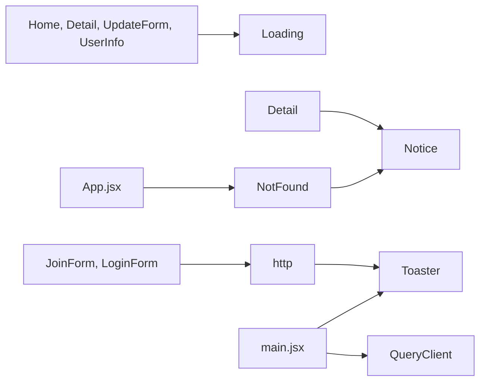

만든 장: error-handling
맡는 파일
- react-blog/src/components/Loading.jsx
- react-blog/src/components/Notice.jsx
- react-blog/src/pages/NotFound.jsx
- react-blog/src/pages/Detail.jsx
- react-blog/src/App.jsx
- react-blog/src/api/http.jsx
- react-blog/src/main.jsx
- react-blog/src/pages/JoinForm.jsx
- react-blog/src/pages/LoginForm.jsx

조회는 받는 동안 Loading을 보이고, 없는 글이면 Detail이 Notice로 안내한다.
조회 실패는 400대면 다시 묻지 않고, 500과 연결 실패는 한 번만 다시 묻는다.
쓰기 실패는 http 응답 인터셉터가 서버 msg를 토스트로 띄우고 그 화면에 남는다.
응답이 없으면 조회든 쓰기든 서버에 연결할 수 없다는 토스트를 하나만 띄운다.
없는 주소는 path="*" 라우트가 NotFound로 받는다.
