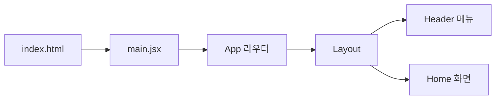

# 시나리오별 구조도

## 앱 띄우기와 메뉴 이동

만든 장: project-setup, layout
맡는 파일
- react-blog/index.html
- react-blog/src/main.jsx
- react-blog/src/App.jsx
- react-blog/src/components/Layout.jsx
- react-blog/src/components/Header.jsx
- react-blog/src/pages/Home.jsx
- react-blog/src/index.css

사용자 시나리오(회원가입, 로그인, 글쓰기)는 아직 만든 장이 없다.
