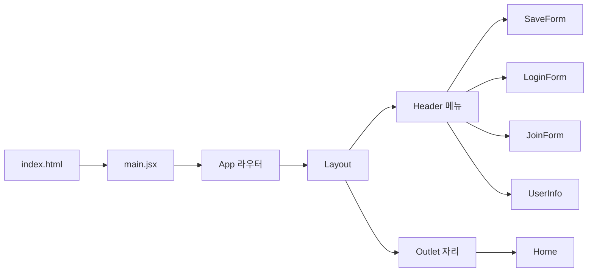
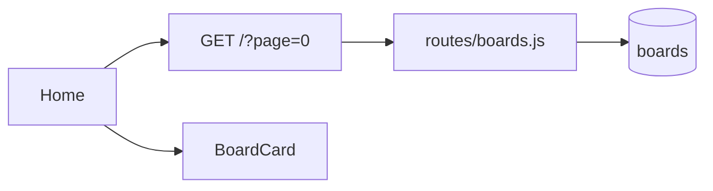
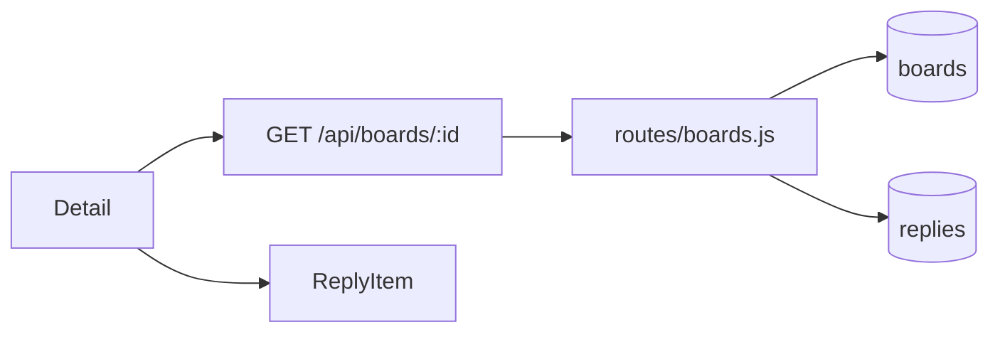
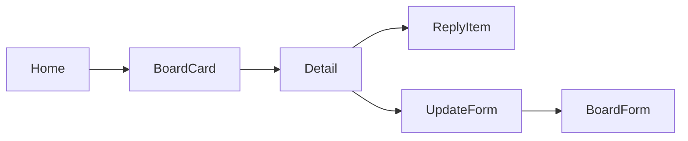
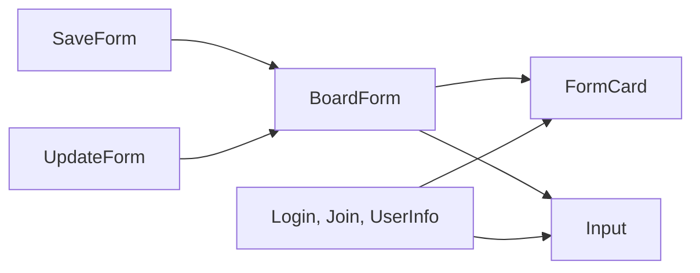

# 시나리오별 구조도

## 앱 띄우기와 메뉴 이동

만든 장: project-setup, layout, screens
맡는 파일
- react-blog/index.html
- react-blog/src/main.jsx
- react-blog/src/App.jsx
- react-blog/src/components/Layout.jsx
- react-blog/src/components/Header.jsx
- react-blog/src/pages/Home.jsx
- react-blog/src/pages/SaveForm.jsx
- react-blog/src/pages/LoginForm.jsx
- react-blog/src/pages/JoinForm.jsx
- react-blog/src/pages/UserInfo.jsx
- react-blog/src/index.css

## 글 목록 보기

만든 장: screens, component-split, board-list
맡는 파일
- react-blog/src/pages/Home.jsx
- react-blog/src/components/BoardCard.jsx
- server-node/src/routes/boards.js
- server-node/src/db.js

## 글 상세 보기

만든 장: screens, component-split, board-detail
맡는 파일
- react-blog/src/pages/Detail.jsx
- react-blog/src/components/ReplyItem.jsx
- server-node/src/routes/boards.js
- server-node/src/db.js

## 글 보기에서 수정 화면까지

만든 장: screens, component-split, board-list, board-detail
맡는 파일
- react-blog/src/pages/Home.jsx
- react-blog/src/components/BoardCard.jsx
- react-blog/src/pages/Detail.jsx
- react-blog/src/components/ReplyItem.jsx
- react-blog/src/pages/UpdateForm.jsx
- react-blog/src/components/BoardForm.jsx
- react-blog/src/App.jsx

## 폼 화면 조각

만든 장: screens, component-split
맡는 파일
- react-blog/src/components/FormCard.jsx
- react-blog/src/components/Input.jsx
- react-blog/src/components/BoardForm.jsx
- react-blog/src/pages/SaveForm.jsx
- react-blog/src/pages/UpdateForm.jsx
- react-blog/src/pages/LoginForm.jsx
- react-blog/src/pages/JoinForm.jsx
- react-blog/src/pages/UserInfo.jsx

홈 목록과 상세는 서버에서 받는다. 폼 화면은 아직 예시 글자다. 회원가입, 로그인, 글쓰기 시나리오는 아직 만든 장이 없다.
