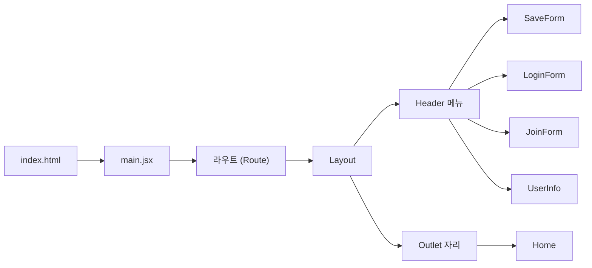
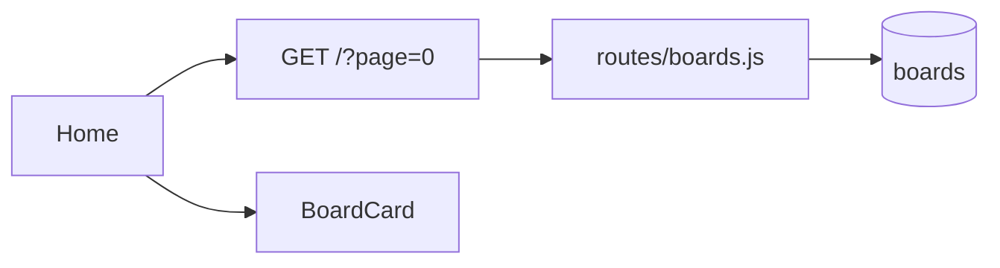
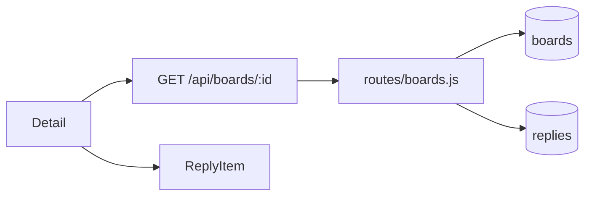
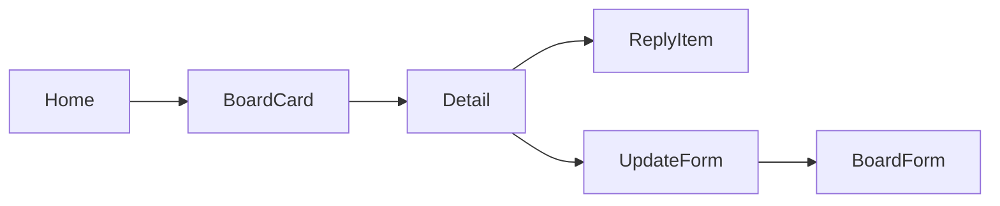
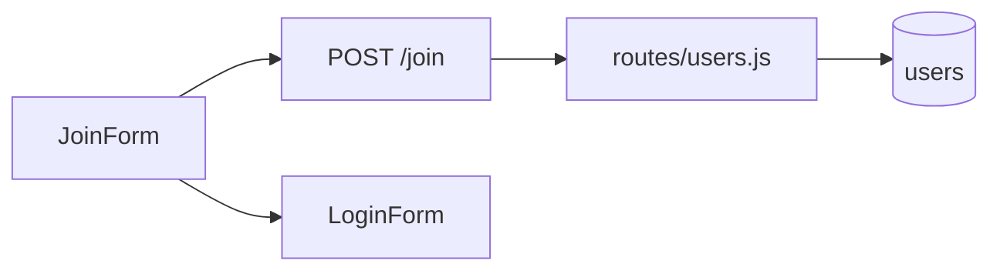
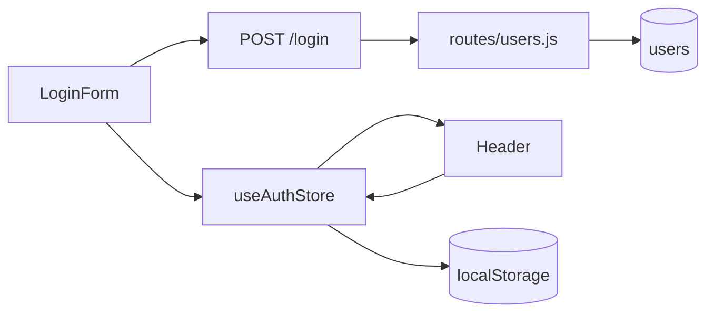
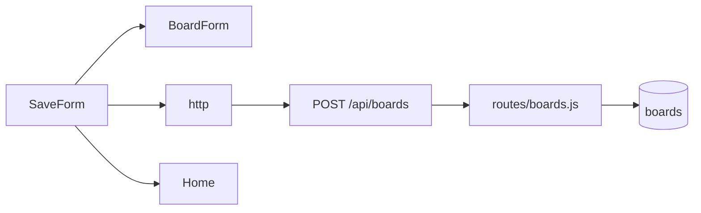
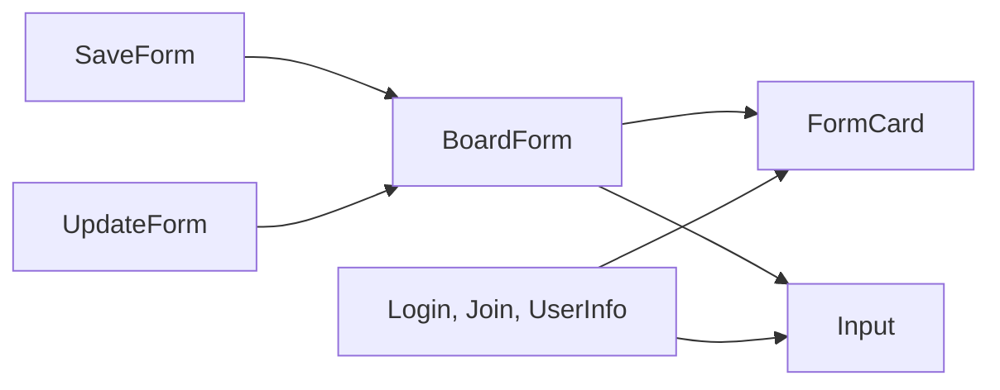

# 시나리오별 구조도

## 앱 띄우기와 메뉴 이동

만든 장: project-setup, layout, screens
맡는 파일
- react-blog/index.html
- react-blog/src/main.jsx
- react-blog/src/App.jsx
- react-blog/src/components/Layout.jsx
- react-blog/src/components/Header.jsx
- react-blog/src/pages/Home.jsx
- react-blog/src/pages/SaveForm.jsx
- react-blog/src/pages/LoginForm.jsx
- react-blog/src/pages/JoinForm.jsx
- react-blog/src/pages/UserInfo.jsx
- react-blog/src/index.css

## 글 목록 보기

만든 장: screens, component-split, board-list, board-save
맡는 파일
- react-blog/src/pages/Home.jsx
- react-blog/src/components/BoardCard.jsx
- react-blog/src/api/http.jsx
- server-node/src/routes/boards.js
- server-node/src/db.js

## 글 상세 보기

만든 장: screens, component-split, board-detail, board-save
맡는 파일
- react-blog/src/pages/Detail.jsx
- react-blog/src/components/ReplyItem.jsx
- react-blog/src/api/http.jsx
- server-node/src/routes/boards.js
- server-node/src/db.js

## 글 보기에서 수정 화면까지

만든 장: screens, component-split, board-list, board-detail
맡는 파일
- react-blog/src/pages/Home.jsx
- react-blog/src/components/BoardCard.jsx
- react-blog/src/pages/Detail.jsx
- react-blog/src/components/ReplyItem.jsx
- react-blog/src/pages/UpdateForm.jsx
- react-blog/src/components/BoardForm.jsx
- react-blog/src/App.jsx

## 회원가입

만든 장: screens, component-split, join, board-save
맡는 파일
- react-blog/src/pages/JoinForm.jsx
- react-blog/src/components/FormCard.jsx
- react-blog/src/components/Input.jsx
- react-blog/src/api/http.jsx
- server-node/src/routes/users.js
- server-node/src/db.js

## 로그인과 로그아웃

만든 장: screens, component-split, login, login-keep, board-save
맡는 파일
- react-blog/src/pages/LoginForm.jsx
- react-blog/src/store/authStore.jsx
- react-blog/src/components/Header.jsx
- react-blog/src/components/FormCard.jsx
- react-blog/src/components/Input.jsx
- react-blog/src/api/http.jsx
- server-node/src/routes/users.js
- server-node/src/auth.js

## 글쓰기

만든 장: screens, component-split, board-save
맡는 파일
- react-blog/src/pages/SaveForm.jsx
- react-blog/src/components/BoardForm.jsx
- react-blog/src/api/http.jsx
- server-node/src/routes/boards.js
- server-node/src/auth.js

## 폼 화면 조각

만든 장: screens, component-split
맡는 파일
- react-blog/src/components/FormCard.jsx
- react-blog/src/components/Input.jsx
- react-blog/src/components/BoardForm.jsx
- react-blog/src/pages/SaveForm.jsx
- react-blog/src/pages/UpdateForm.jsx
- react-blog/src/pages/LoginForm.jsx
- react-blog/src/pages/JoinForm.jsx
- react-blog/src/pages/UserInfo.jsx

홈 목록과 상세는 서버에서 받는다.
회원가입은 서버에 저장한다.
로그인은 토큰을 받아 스토어에 기억하고 헤더가 그것을 본다.
토큰은 localStorage에도 남아 새로고침해도 로그인이 유지된다. 로그아웃하면 지운다.
서버 요청은 모두 http를 지나고, 로그인했으면 토큰이 붙는다.
글쓰기는 토큰과 함께 보내고 홈으로 간다.
글 수정, 내 정보 폼은 아직 보내지 않는다.
