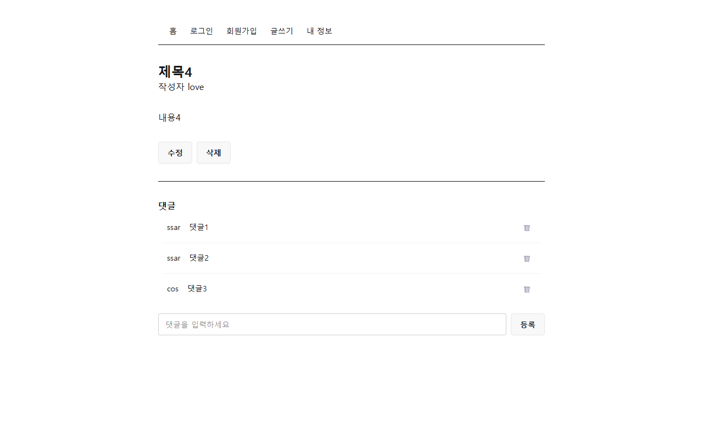
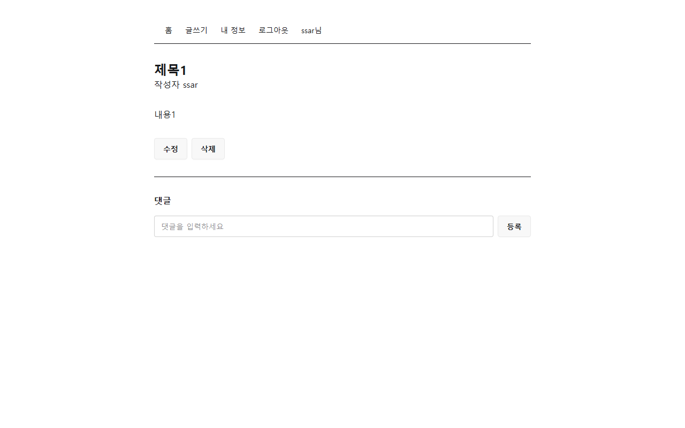
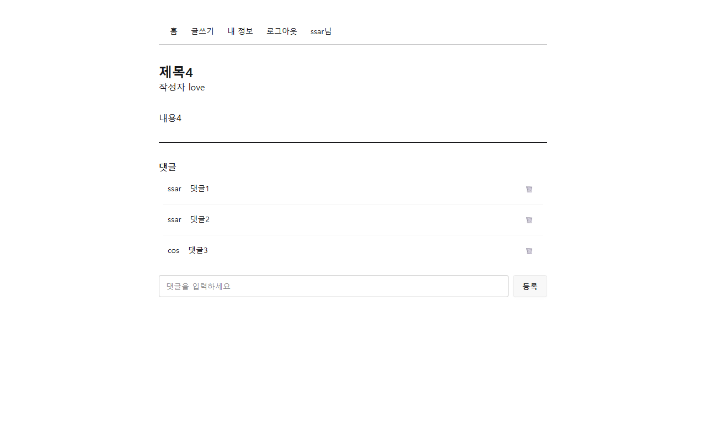
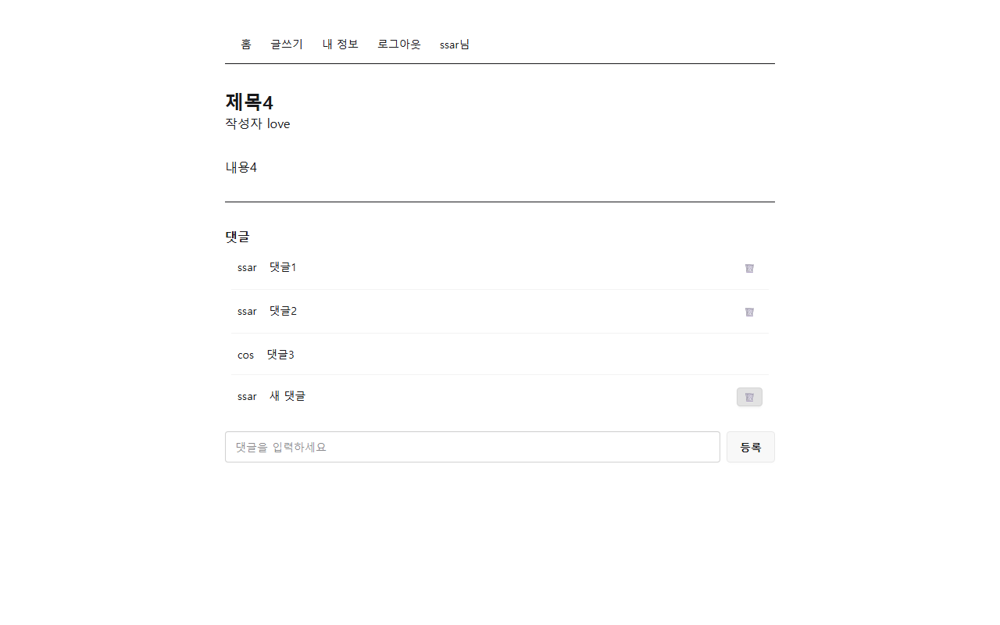
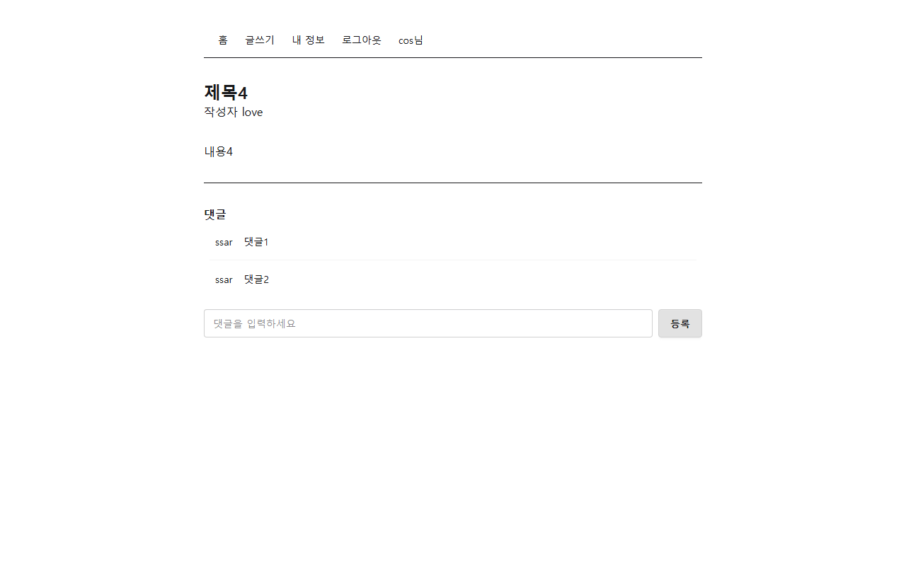
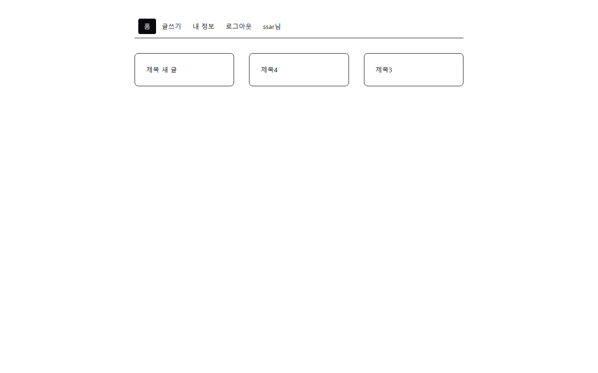
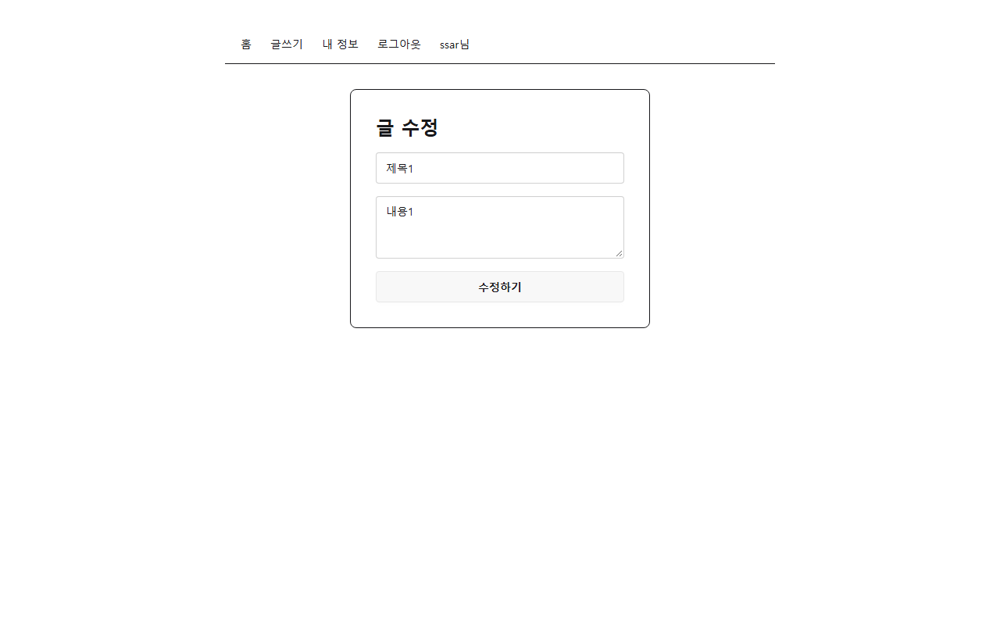
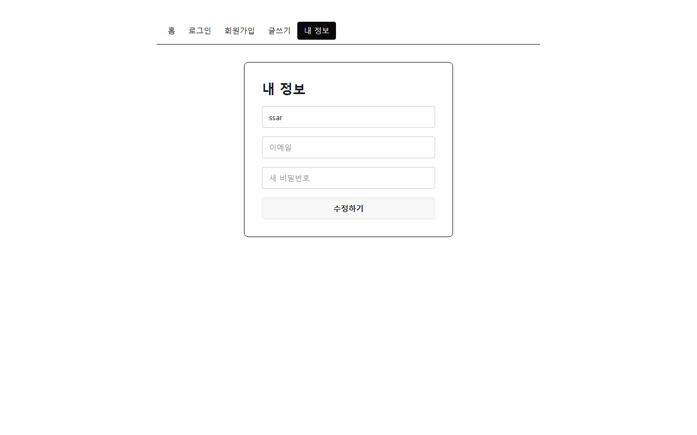
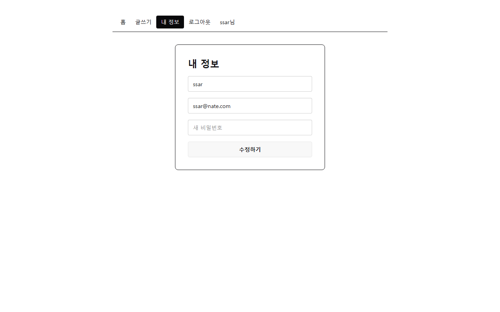

# 화면 모음

## 홈 (출발점)
처음 나온 장: project-setup

## 홈 (레이아웃과 헤더)
처음 나온 장: layout

## 홈 (글 카드)
처음 나온 장: screens

## 홈 (서버 글 목록)
처음 나온 장: board-list

## 상세
처음 나온 장: screens

## 상세 (서버 글)
처음 나온 장: board-detail

## 상세 (내 글, 수정과 삭제 버튼)
처음 나온 장: board-update-delete

## 상세 (남의 글, 버튼 없음)
처음 나온 장: board-update-delete

## 상세 (내 댓글에만 휴지통)
처음 나온 장: reply

## 상세 (댓글 등록 뒤)
처음 나온 장: reply

## 상세 (댓글 삭제 뒤)
처음 나온 장: reply

## 글쓰기
처음 나온 장: screens

## 홈 (글쓰기 뒤 새 글)
처음 나온 장: board-save

## 글 수정
처음 나온 장: screens

## 글 수정 (기존 값 채움)
처음 나온 장: board-update-delete

## 로그인
처음 나온 장: screens

## 회원가입
처음 나온 장: screens

## 회원가입 뒤 로그인 화면
처음 나온 장: join

## 홈 (로그인 뒤 헤더)
처음 나온 장: login

## 홈 (로그아웃 뒤 헤더)
처음 나온 장: login

## 홈 (새로고침해도 로그인 유지)
처음 나온 장: login-keep

## 홈 (로그아웃 뒤 새로고침)
처음 나온 장: login-keep

## 내 정보
처음 나온 장: screens

## 내 정보 (받은 값 채움)
처음 나온 장: my-info

## 내 정보 (수정 뒤 다시 들어옴)
처음 나온 장: my-info

## 홈 (새 비밀번호로 로그인)
처음 나온 장: my-info

